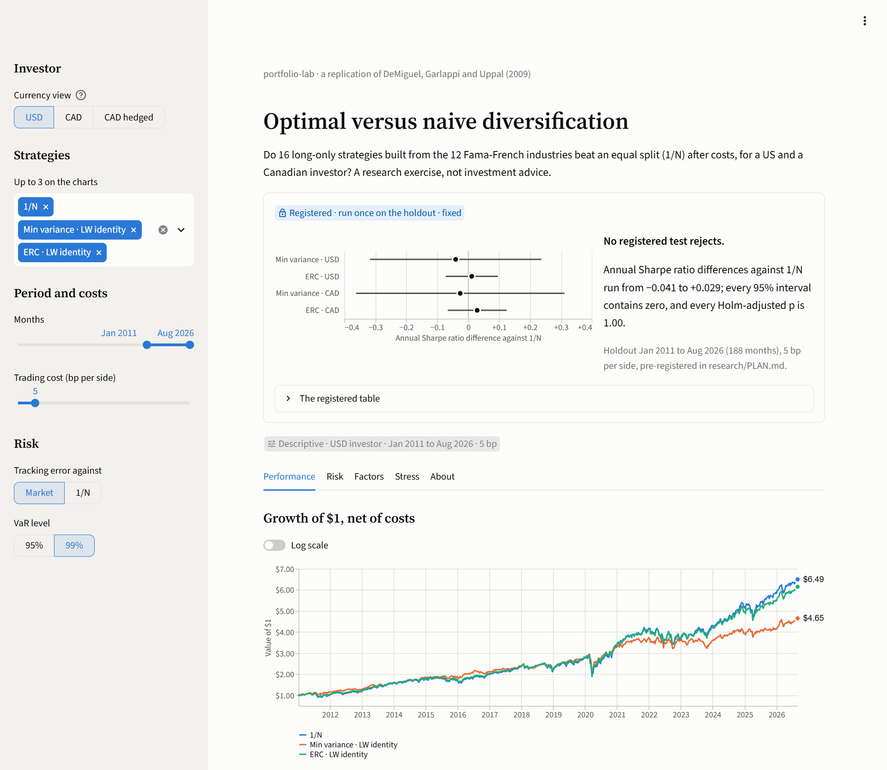

# portfolio-lab

**Does optimization beat naive 1/N diversification after costs, out of sample, for a USD
investor and for a Canadian investor?** A pre-registered replication and extension of
DeMiguel, Garlappi and Uppal (2009), "Optimal versus naive diversification" (*Review of
Financial Studies* 22(5)), with risk-model validation.

By **Cristian Ciorba**, Finance student at HEC Montréal ·
[LinkedIn](https://www.linkedin.com/in/cristian-ciorba-6a70b0381)

[](https://github.com/cristian4269/portfolio-lab/actions/workflows/ci.yml)

[](LICENSE)

**Live dashboard: [portfolio-lab-demo.streamlit.app](https://portfolio-lab-demo.streamlit.app/)**
(free hosting: after 12 hours without a visit it sleeps, and the next visit wakes it).

<picture>
  <source media="(prefers-color-scheme: dark)" srcset="docs/img/dashboard-dark.png">
  
</picture>

## Headline results

Holdout: January 2011 to August 2026, 188 months, run once. Details in
[research/REPORT.md](research/REPORT.md).

1. **No pre-registered test rejects.** Neither minimum variance nor equal risk contribution
   (ERC) beat 1/N after costs over the holdout. Every Holm-adjusted p-value is 1.00. The four
   annual Sharpe differences against 1/N run from −0.041 to +0.029, and every 95% interval
   contains zero.
2. **Minimum variance did its job.** It cut volatility from 16.7% to 13.8% and the worst
   drawdown from −36.7% to −32.7% (USD, against 1/N). Its lower return cancelled that gain in
   Sharpe terms: 0.76 against 0.80.
3. **The tests are honest about power.** Over 188 months they detect only annual Sharpe
   differences of about 0.4-0.5 for minimum variance and about 0.12 for ERC, so a null was the
   expected outcome. It does not show that the strategies are equal.
4. **Only filtered historical simulation forecasts the 95% VaR well.** Of four one-day VaR
   methods, it alone gets the 95% exceptions at the right rate and without clustering, in all
   6 series (three portfolios, two currency views). At 99% no method passes Christoffersen's
   conditional coverage test in more than 1 of 6 series, though every series stays in the
   Basel green zone ([REPORT §8](research/REPORT.md#8-risk-model-validation-var-backtests-and-stress)).

## What this demonstrates

- **Research design.** A pre-registered test with a one-shot holdout that the code enforces:
  the holdout command refuses to run unless the plan matches its git tag
  ([REPORT §2](research/REPORT.md#2-question-and-pre-registration)).
- **Statistical inference.** Ledoit and Wolf's (2008) studentized block bootstrap of Sharpe
  ratio differences, Holm's correction, and a power analysis stated before the holdout and
  checked after it ([REPORT §5](research/REPORT.md#5-primary-results)).
- **Portfolio construction and backtesting.** Ledoit-Wolf shrinkage, long-only minimum
  variance and equal risk contribution, and a walk-forward backtest that trades at the next
  close and pays its costs ([`construct/`](src/portfolio_lab/construct/),
  [`backtest/`](src/portfolio_lab/backtest/)).
- **Market risk.** One-day VaR and expected shortfall by four methods, VaR backtests (Kupiec,
  Christoffersen, the Basel traffic light), and historical and hypothetical stress tests
  ([REPORT §8](research/REPORT.md#8-risk-model-validation-var-backtests-and-stress),
  [`risk/`](src/portfolio_lab/risk/), [`stress/`](src/portfolio_lab/stress/)).
- **Factors and currency.** Fama-French five-factor and momentum regressions with Newey-West
  errors, for a USD investor and a Canadian one, unhedged or hedged
  ([`risk/factors.py`](src/portfolio_lab/risk/factors.py),
  [`data/views.py`](src/portfolio_lab/data/views.py)).
- **Honest reporting.** A null result stated with its power, exploratory results kept apart
  from the registered ones, and a section on what failed or changed
  ([REPORT §10](research/REPORT.md#10-what-failed-or-changed)).
- **Reproducible, tested code.** Typed Python, a pytest suite in CI, every financial formula
  tested against a hand-computed or textbook value, and one command that rebuilds the results
  from a data vintage recorded by SHA-256 ([`tests/`](tests/),
  [`manifest.json`](research/results/manifest.json)).
- **Communication.** A [live dashboard](https://portfolio-lab-demo.streamlit.app/) that keeps
  the registered result fixed and labels everything else descriptive.

## Method in brief

**Pre-registered, then run once.** [research/PLAN.md](research/PLAN.md) fixed the hypotheses,
the estimator rule, the test and the holdout before any holdout number existed. The git
history is the evidence ([REPORT §2](research/REPORT.md#2-question-and-pre-registration)):

| Date | Commit | Event |
|---|---|---|
| 2026-10-09 | `0f3c664` | Draft plan committed, before any strategy was compared on dev data |
| 2026-10-11 | `317d4c4` | Plan frozen and tagged `prereg-v1` |
| 2026-10-11 | `adccda8` | The one-shot holdout run, on code identical to the tag |
| 2026-10-11 | `3077287` | The registered robustness checks, run after the holdout |

The holdout command refuses to run unless the tag is an ancestor of HEAD and PLAN.md matches
its tagged copy, the cached data match the frozen vintage, the source is committed, and no
holdout run is recorded yet.

- **Walk-forward backtest.** Monthly rebalancing on a 252-day window: estimate through the
  close of the last trading day, trade at the next close, pay 5 bp per side.
- **Strategies.** 1/N, plus long-only minimum variance and ERC as the primary pair. Sixteen
  strategies besides 1/N in all (capped, EWMA and tilt variants); only the primary pair
  carries a hypothesis, and the other comparisons are exploratory.
- **Covariance.** Ledoit-Wolf shrinkage toward a scaled identity, chosen on dev data by the
  lowest minimum variance volatility, a rule that never looks at a mean or a Sharpe ratio.
- **Test.** Ledoit and Wolf's (2008) studentized circular block bootstrap of the Sharpe ratio
  difference against 1/N, on monthly net excess returns. Four primary tests (two strategies,
  two views), two-sided, with Holm's correction at a 5% family-wise error rate.
- **Currency views.** USD; CAD unhedged; CAD hedged by covered interest parity (descriptive
  only, since its excess return equals the USD one).
- **Luck and robustness.** The luck benchmark compares each strategy with 1000 random
  long-only shadows at its own turnover and cost. Robustness checks change one thing at a time
  (windows of 126 and 504 days, costs of 0, 10 and 20 bp, the 49 industries) and are
  descriptive.
- **Risk validation.** One-day VaR and expected shortfall at 95% and 99% on a 500-day window,
  by four methods (historical, normal, Cornish-Fisher, filtered historical simulation).
  Exceptions are backtested with Kupiec's test, Christoffersen's independence and conditional
  coverage tests, and the Basel zones. On the holdout, only filtered historical simulation
  gets the 95% exceptions at the right rate and without clustering.
- **Factor regressions.** Weekly excess returns on the Fama-French five factors and momentum,
  with Newey-West errors. The CAD view adds USD/CAD and the Canadian 10-year yield.
- **Stress tests.** The 2008 crisis, the 2020 COVID crash and the 2022 rate shock, replayed on
  the final holdings and as each strategy actually ran; plus hypothetical shocks (US market
  −20%, Canadian 10-year +200 bp, CAD +10%) through partial betas.

REPORT [§10](research/REPORT.md#10-what-failed-or-changed) lists what failed or changed along
the way.

## The dashboard

An interactive view of the study in Streamlit,
[live on Streamlit Community Cloud](https://portfolio-lab-demo.streamlit.app/), with five
tabs: **Performance**, **Risk**, **Factors**, **Stress** and **About**.

- **Registered results are fixed.** A strip above the tabs shows the four pre-registered
  tests as they ran once on the holdout. It does not move with the controls.
- **The rest is descriptive and live.** The currency view, strategies, months, trading cost
  and benchmark drive the growth and drawdown charts, metrics and holdings, VaR backtests,
  factor betas and stress windows.

The data bundle is committed in `app/data/`, so the app downloads nothing. A host installs
`app/requirements.txt` (exported from `uv.lock`) and needs Python 3.13 or later; on Streamlit
Community Cloud, pick 3.13 in the deploy's advanced settings. To run it locally (needs
[uv](https://docs.astral.sh/uv/)):

```bash
uv sync --group app
uv run --group app streamlit run app/streamlit_app.py
```

## How it was built

portfolio-lab was built with Claude Code, Anthropic's AI coding assistant. The assistant
proposed the plans and wrote most of the code and tests. Cristian Ciorba chose the design among
its proposals, approved each step's plan before any code was written, and approved every push,
merge and the pre-registration freeze. Those decisions are logged in [`plans/`](plans/) and
[NOTES.md](NOTES.md). The results do not rest on trusting either of them: every financial
formula is tested against a hand-computed or textbook value, and one command regenerates the
report.

## Limitations

- **Power.** Even 188 months cannot separate minimum variance from 1/N unless their annual
  Sharpe ratios differ by about 0.4.
- **Expected shortfall is not backtested.** The library forecasts it beside VaR and the
  dashboard shows it, but only the VaR exceptions are backtested.
- **Untradable assets.** Industry portfolios are not investable as such. The 5 bp cost stands
  in for an ETF or a basket and leaves out market impact and currency costs.
- **Known history.** The author and the AI assistant both know that 2011-2026 was a strong,
  technology-led US market. The pre-registration rules out tuning on these series, not that
  knowledge.
- **One vintage.** The French library is revised when CRSP updates. The numbers hold for the
  vintage frozen on 2026-10-10; a newer one warns and may drift.
- **One design.** Long-only, monthly, 12 industries. DeMiguel et al. also study short sales,
  other datasets and other estimators.
- **FX timing.** USD/CAD is the New York noon rate, against close-to-close equity returns,
  which adds noise to daily CAD returns.

## How to reproduce

```bash
uv sync --all-groups
uv run pytest                                      # offline tests; -m network for live data
uv run portfolio-lab reproduce --refresh           # download every source, run the dev analysis
uv run portfolio-lab reproduce --holdout --rerun   # the holdout, recorded apart from the one-shot
uv run portfolio-lab reproduce --robustness        # after the holdout
uv run portfolio-lab reproduce --dashboard         # rebuild the bundle in app/data/
uv run portfolio-lab figures                       # research/figures/
```

- **A fresh clone has no data.** The first run needs `--refresh`, which downloads every
  source (about 8 minutes with the dev analysis). Later runs read the cache.
- **Exact reproduction needs the frozen vintage.** If a source has changed since 2026-10-10,
  the dev run warns and names it. The holdout and robustness runs then refuse unless
  `--accept-drift` is passed, and their numbers may drift.
  [`research/results/manifest.json`](research/results/manifest.json) records every source's
  SHA-256, the commit and the package versions. Result tables are not committed, only the
  manifest and the figures.
- **CI** runs ruff, mypy and pytest with coverage on every push, and checks that the
  dashboard's deploy requirements (`app/requirements.txt`) match `uv.lock`
  ([`ci.yml`](.github/workflows/ci.yml)).

## Project layout

```
src/portfolio_lab/
  data/          loaders for the four sources; the USD, CAD and hedged views
  construct/     covariance estimators, minimum variance, ERC, tilts
  backtest/      walk-forward engine, benchmarks, luck benchmark
  risk/          VaR and ES, VaR backtests, factor regressions
  stress/        historical replays, hypothetical shocks
  report/        metrics, Sharpe inference, figures
  study.py       the pre-registered study as code
  robustness.py  the registered robustness checks
  dashboard.py   the dashboard's data bundle
  manifest.py    the results manifest (sources' SHA-256s, commit, versions)
  cli.py         the portfolio-lab command (reproduce, figures)
app/             the Streamlit dashboard and its data bundle (app/data/)
research/        PLAN.md (pre-registration), REPORT.md (holdout report), figures/, results/
tests/           the pytest suite
plans/           the blueprint and a plan for each step
```

The build process is public on purpose: [`plans/`](plans/) holds the blueprint and the plan
for each step, and [NOTES.md](NOTES.md) the running log of decisions and findings.

## Data sources and licenses

Only free, keyless sources, fetched at runtime. No source file is committed. The dashboard's
bundle holds daily series built from them: portfolio returns, the Fama-French market and
factors, USD/CAD returns and Canadian yield changes. Terms and citations:
[DATA_SOURCES.md](DATA_SOURCES.md).

- **[Kenneth R. French Data Library][french]:** 12 industry portfolios (49 for robustness),
  Fama-French five factors and momentum, daily. Copyright notice only, no explicit reuse
  terms; cited.
- **[Federal Reserve Board](https://www.federalreserve.gov/releases/h10/), via
  [FRED](https://fred.stlouisfed.org/legal/):** USD/CAD, the H.10 noon buying rates
  (`DEXCAUS`). Public domain, cited to the Board; DATA_SOURCES.md notes FRED's own terms.
- **[Bank of Canada](https://www.bankofcanada.ca/terms/) (Valet API):** the 10-year benchmark
  yield. Attribution required, with a note of any change.
- **[Statistics Canada](https://www.statcan.gc.ca/en/reference/licence):** the 3-month
  T-bill and the 10-year yield's monthly history, table 10-10-0122-01. Statistics Canada Open
  Licence.

[french]: https://mba.tuck.dartmouth.edu/pages/faculty/ken.french/data_library.html

## License

Code: [MIT](LICENSE). Data keeps its own terms (see DATA_SOURCES.md).

Research on historical data for education; not investment advice.
