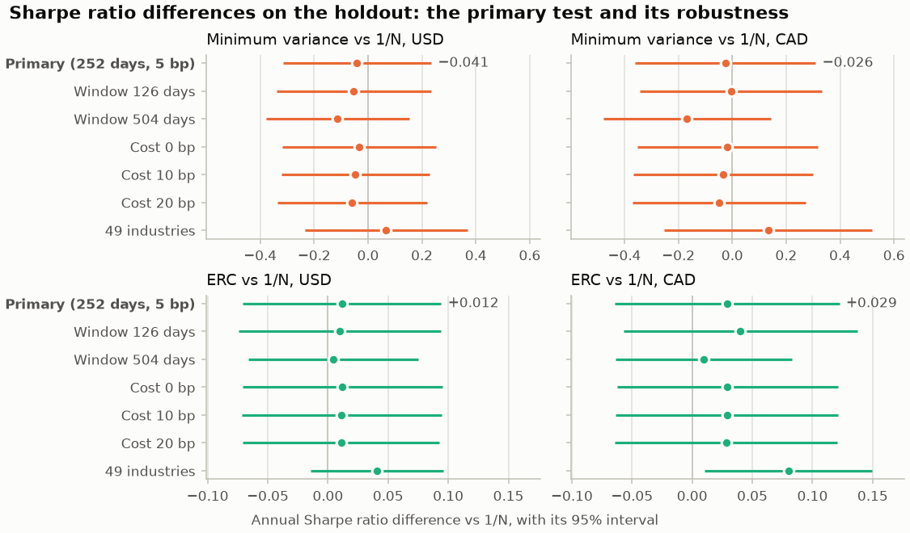
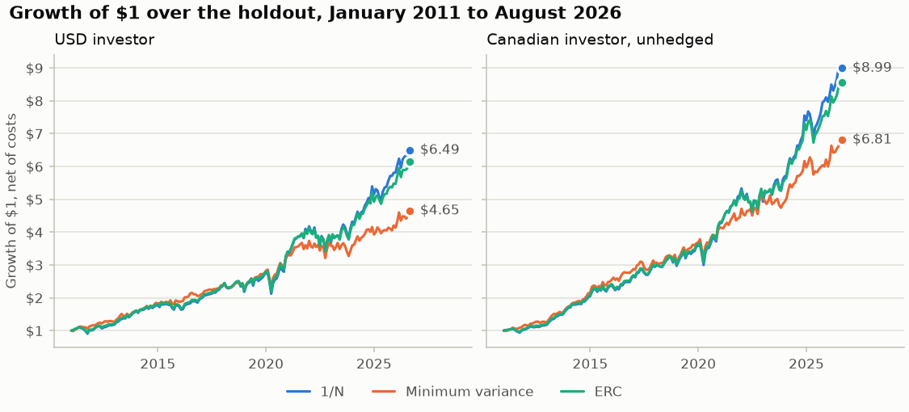
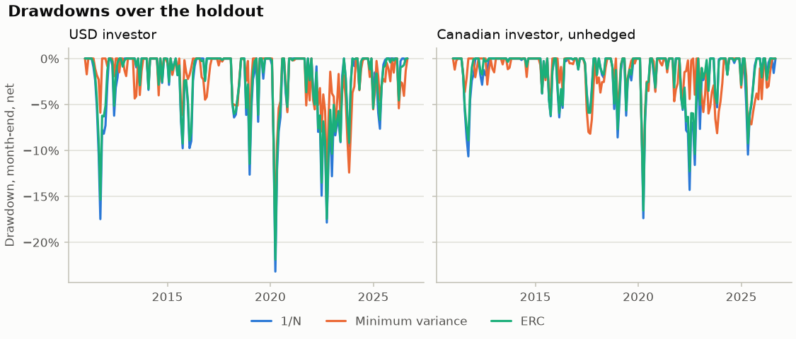
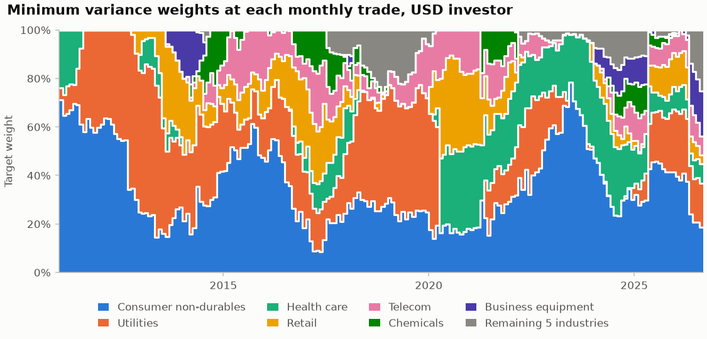
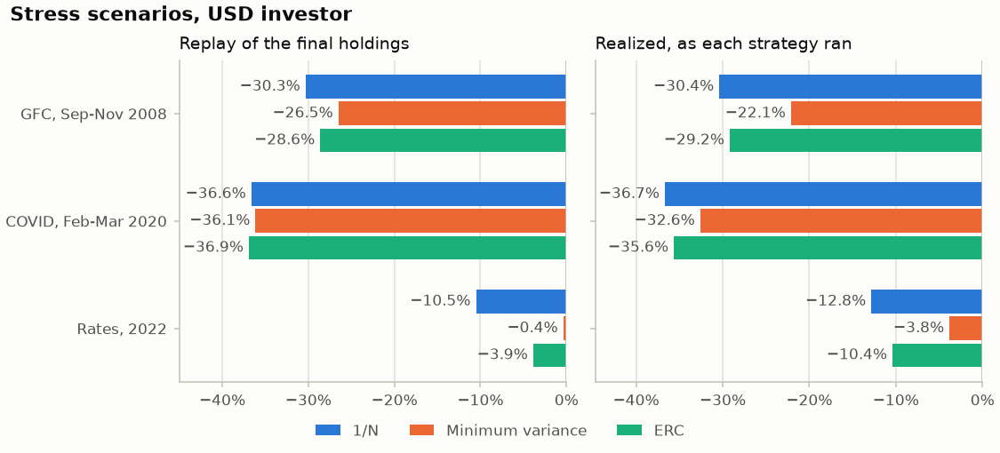

# Optimal versus naive diversification for a Canadian investor: the holdout report

**Pre-registered** in [`research/PLAN.md`](PLAN.md), frozen at the tag `prereg-v1` (commit
`317d4c4`) before any holdout number existed. **Holdout:** January 2011 to August 2026, 188
months, run once on 2026-10-11. Every number here comes from `uv run portfolio-lab reproduce`
(see [How to reproduce](#13-how-to-reproduce)). This is a research exercise, not investment
advice.

## 1. The answer

- **Neither minimum variance nor equal risk contribution (ERC) beat the naive 1/N portfolio
  after costs, risk-adjusted, out of sample.** None of the four pre-registered tests rejects;
  every Holm-adjusted p-value is 1.00.
- **The point estimates are small.** Minimum variance's annual Sharpe ratio is 0.04 below
  1/N's (USD) and 0.03 below (CAD). ERC's is 0.01 and 0.03 above.
- **Minimum variance did what it is built for.** It cut volatility from 16.7% to 13.8% (USD)
  and the worst drawdown from −36.7% to −32.7%. Its lower return cancelled that gain in Sharpe
  terms.
- **The tests are weak by construction.** Over 188 months they detect only annual Sharpe
  differences of about 0.4-0.5 for minimum variance and about 0.12 for ERC. A null result
  is the expected outcome and does not show that the strategies are equal.
- **The robustness checks tell the same story.** Of 24 descriptive robustness tests, one
  has a raw p below 0.05 (ERC on the 49 industries, CAD), about what chance gives.

## 2. Question and pre-registration

> Do long-only minimum variance and ERC portfolios beat 1/N after transaction costs,
> risk-adjusted, for a USD investor and for a Canadian investor who holds the same US assets
> unhedged, out of sample?

This replicates and extends DeMiguel, Garlappi and Uppal (2009), "Optimal versus naive
diversification" (*Review of Financial Studies* 22(5)).
- **The extensions:** shrinkage covariance estimators, ERC, a CAD view, transaction costs, a
  time-series-robust Sharpe test, a luck benchmark, and risk-model validation.
- **Prior knowledge** (declared in PLAN.md §11): both the owner and the assistant knew in
  advance that 1/N is hard to beat and that the low-volatility anomaly exists. The holdout
  guards against tuning on these series, not against that knowledge.

**The timeline** (git history; times are Eastern):

| Date | Commit | Event |
|---|---|---|
| 2026-10-01 | | Blueprint approved: the holdout split (2011-01 on) and the design fixed |
| 2026-10-09 19:49 | `0f3c664` | The draft PLAN.md, committed before any strategy was compared on dev data |
| 2026-10-09 21:25 | `5b9144b` | The data vintage frozen; HOLDOUT_END = 2026-08-31 |
| 2026-10-11 14:49 | `317d4c4` | PLAN.md frozen with the dev decisions, and tagged `prereg-v1` (pushed after PR #9 merged at 15:14) |
| 2026-10-11 15:29 | `9ca40f4` | The Step 7b plan approved |
| 2026-10-11 15:30 | `adccda8` | **The one-shot holdout run** (`reproduce --holdout`, 298 s), on code identical to the tag |
| 2026-10-11 15:58 | `3077287` | The registered robustness checks, run after the holdout |

The command that runs the holdout refuses unless four things hold:
- the tag is an ancestor of HEAD, and PLAN.md is identical to its tagged copy;
- the cached data match the vintage frozen at the tag;
- the source code is committed;
- no holdout run is recorded yet.

The results manifest records that the holdout ran on commit `9ca40f4` with no source file
changed since the tag.

## 3. Data

| Series | Source | Use |
|---|---|---|
| 12 (and 49) industry portfolios, daily, value-weighted | Kenneth R. French Data Library | The investable assets (49: robustness) |
| Fama-French 5 factors + momentum, daily | French | US risk-free rate, the market, factor betas |
| USD/CAD, noon New York rate | FRED `DEXCAUS` | The CAD views |
| 3-month T-bill | Statistics Canada 10-10-0122-01 | The Canadian risk-free rate |
| 10-year benchmark yield | Bank of Canada Valet | The rate shock |

- **The vintage:** every source was downloaded on 2026-10-10 (UTC), and the manifest
  records each file's SHA-256. The French files carry "202608 CRSP database" headers.
- **The views:**
  - USD;
  - CAD unhedged, (1 + r)(1 + fx) − 1;
  - CAD hedged by covered interest parity, r + rf_CAD − rf_USD.
- **Excess returns** use each view's own risk-free rate.
- **This report shows portfolio results only:** returns, weights and statistics, never an
  industry's own return series. The French library carries a copyright notice and no
  explicit reuse terms; it is cited here and in `DATA_SOURCES.md`.

## 4. Method

- **Strategies** (PLAN.md §4, §6):
  - 1/N.
  - Long-only minimum variance and ERC on a 252-day window.
  - The covariance estimator is Ledoit-Wolf shrinkage to a scaled identity (`lw_identity`).
    It was chosen on dev data by the lowest minimum variance volatility, a rule that never
    looks at a mean or a Sharpe ratio. The three candidates nearly tied: 12.71%, 12.77%
    and 12.82%.
  - **Sixteen strategies in all,** with capped, EWMA and tilt variants. The non-primary ones
    are exploratory.
- **The backtest:**
  - Rebalancing is monthly, estimated through the close of the last trading day and traded
    at the next close.
  - Costs are 5 bp per side on the traded amount.
  - Each strategy runs continuously from its first dev rebalance to HOLDOUT_END, and the
    holdout months are then cut out.
- **The test** (PLAN.md §5): Ledoit and Wolf's (2008) studentized circular block bootstrap
  of the difference in Sharpe ratios.
  - It runs on monthly net excess returns, with M = 4999 resamples.
  - The standard error on the original data is a prewhitened Parzen HAC, as in the authors'
    `bootTimeInference` code.
  - The block size comes from their Algorithm 3.1 (K = 1000 pseudo-series), recalibrated
    on the holdout.
  - Sharpe ratios are monthly × √12.
- **The family:** the four primary tests (two strategies × two views), two-sided, Holm at a
  5% family-wise error rate. Jobson-Korkie with Memmel's correction is a secondary check.
- **Power** (PLAN.md §8): the minimum detectable difference at 80% power was stated in advance
  from the dev standard errors.

## 5. Primary results

| Pair vs 1/N | View | Δ̂ (annual Sharpe) | 95% CI | Block | LW p | Holm p | JK-M p |
|---|---|---|---|---|---|---|---|
| Minimum variance | USD | −0.041 | [−0.315, 0.234] | 2 | 0.77 | 1.00 | 0.77 |
| Minimum variance | CAD | −0.026 | [−0.360, 0.309] | 1 | 0.88 | 1.00 | 0.88 |
| ERC | USD | +0.012 | [−0.071, 0.094] | 1 | 0.79 | 1.00 | 0.70 |
| ERC | CAD | +0.029 | [−0.064, 0.122] | 1 | 0.54 | 1.00 | 0.44 |

- **No test rejects.** By PLAN.md §3's reading rule, each reads "no detectable difference at
  this power", never "equal".
- **The block calibration** chose blocks of 1-2 months. Every rejection rate on the
  pseudo-series was at or below 4.4%, so the test is slightly conservative here, as it was on
  dev.

**Power, stated against what was realized.** The pre-registered minimum detectable difference
(MDE) used the dev standard errors. The holdout's own standard errors give the realized MDE:

| Pair | MDE planned (dev SE) | MDE realized (holdout SE) |
|---|---|---|
| Minimum variance, USD | 0.48 | 0.39 |
| Minimum variance, CAD | 0.51 | 0.47 |
| ERC, USD | 0.057 | 0.117 |
| ERC, CAD | 0.059 | 0.131 |

- Minimum variance's tests were a little stronger than planned.
- ERC's were half as strong: its difference with 1/N varied about twice as much on the holdout
  as on dev. Section 10 comes back to this.

<picture>
  <source media="(prefers-color-scheme: dark)" srcset="figures/sharpe_differences-dark.png">
  
</picture>

## 6. Performance and risk

Holdout, net of costs, daily metrics except where marked (Sharpe and CEQ are monthly):

| View | Portfolio | Sharpe | CAGR | Volatility | Max drawdown | CVaR 95% (daily) | CEQ (annual) | Turnover / year | Cost / year (bp) |
|---|---|---|---|---|---|---|---|---|---|
| USD | 1/N | 0.80 | 12.7% | 16.7% | −36.7% | 2.53% | 10.4% | 0.15 | 1.5 |
| USD | Minimum variance | 0.76 | 10.3% | 13.8% | −32.7% | 2.05% | 8.3% | 0.88 | 8.8 |
| USD | ERC | 0.81 | 12.3% | 15.8% | −35.6% | 2.40% | 10.1% | 0.18 | 1.8 |
| CAD | 1/N | 1.14 | 15.1% | 16.0% | −30.4% | 2.35% | 12.5% | 0.15 | 1.5 |
| CAD | Minimum variance | 1.11 | 13.1% | 13.8% | −26.6% | 1.93% | 10.7% | 0.94 | 9.4 |
| CAD | ERC | 1.17 | 14.7% | 15.3% | −29.5% | 2.23% | 12.2% | 0.18 | 1.8 |

- **Minimum variance traded return for risk.** It lowered volatility, drawdown and tail
  loss in both views, as designed. It also lowered the return and the certainty equivalent,
  and it traded six times as much as 1/N, though at 5 bp that cost only about 9 bp a year.
- **ERC stayed close to 1/N.** Across twelve industry portfolios of similar risk its weights
  stay near equal.
- **The CAD view gained from the currency.** The USD rose about 39% against the CAD over the
  holdout: $1 in 1/N grew to $6.49 in USD and $8.99 in CAD. The CAD view's slightly lower
  volatility fits the US dollar's tendency to rise when US equities fall.
- **All three lagged the cap-weighted US market.** Their information ratios are −0.36 to −0.45,
  with tracking errors of 4-9%. That is consistent with a period that a few large technology
  firms led, since equal and risk-based industry weights hold less of them.

<picture>
  <source media="(prefers-color-scheme: dark)" srcset="figures/growth-dark.png">
  
</picture>

<picture>
  <source media="(prefers-color-scheme: dark)" srcset="figures/drawdowns-dark.png">
  
</picture>

**Where minimum variance sat.** It is concentrated, as long-only minimum variance always
is:
- consumer non-durables (36% on average), utilities (24%) and health care (12%, up to 42% in
  2020-2024) carry most of the weight;
- telecom, retail and chemicals enter for a few years each;
- Business equipment, the technology industry, is held in only a fifth of the trades.

<picture>
  <source media="(prefers-color-scheme: dark)" srcset="figures/weights-dark.png">
  
</picture>

## 7. Exploratory results and the luck benchmark

- **The 28 exploratory comparisons** (the 14 other strategies, in both views): the smallest
  raw p-value is 0.30 (ERC on EWMA covariance, CAD). The smallest Holm-adjusted p-value over
  all 32 comparisons is 1.00. Nothing exploratory is a finding, as PLAN.md §6 said in advance.
- **The luck benchmark** (PLAN.md §7):
  - Each strategy is compared with 1000 random long-only shadows that trade the same assets
    at its turnover and cost.
  - It measures whether a strategy beat random rebalancing at the same turnover. It is not a
    data-snooping correction; Holm over the 32 comparisons is that.

| View | Portfolio | Sharpe | Percentile among its shadows | Shadow median | Shadow 95th percentile |
|---|---|---|---|---|---|
| USD | 1/N | 0.80 | 0.68 | 0.79 | 0.81 |
| USD | Minimum variance | 0.76 | 0.16 | 0.79 | 0.83 |
| USD | ERC | 0.81 | 0.95 | 0.79 | 0.81 |
| CAD | 1/N | 1.14 | 0.79 | 1.13 | 1.15 |
| CAD | Minimum variance | 1.11 | 0.49 | 1.11 | 1.17 |
| CAD | ERC | 1.17 | 1.00 | 1.13 | 1.15 |

- **Minimum variance:** 84% of its USD shadows did better than it did. Its concentrated
  holdings cost it against random rebalancing at the same turnover.
- **ERC:** it sits at the top of its shadows' range. That range is narrow, though (0.79 to
  0.81 in USD), because a low-turnover shadow stays close to 1/N.
- **Best of 16:** the best actual strategy is reached by the best of 16 shadows in 65% (USD)
  and 32% (CAD) of the replicates. The best strategy is not unusual. (On dev this was 0.000,
  the degenerate case PLAN.md §7 describes.)

## 8. Risk-model validation: VaR backtests and stress

**The VaR backtests** (PLAN.md §10):
- One-day-ahead forecasts on a 500-day window, for 1/N and the primary pair in both views:
  6 series, 3938 holdout days each.
- The table counts how many of the 6 series pass Kupiec's exact test and Christoffersen's
  conditional coverage at 5%.

| Method | Exception rate, 95% | Kupiec, 95% | Cond. coverage, 95% | Exception rate, 99% | Kupiec, 99% | Cond. coverage, 99% |
|---|---|---|---|---|---|---|
| Historical | 4.8-5.0% | 6 of 6 | 1 of 6 | 1.3-1.5% | 2 of 6 | 0 of 6 |
| Normal | 4.3-4.8% | 5 of 6 | 0 of 6 | 1.6-2.3% | 0 of 6 | 0 of 6 |
| Cornish-Fisher | 4.2-5.0% | 5 of 6 | 0 of 6 | 0.7-1.0% | 6 of 6 | 0 of 6 |
| Filtered historical (EWMA 0.94) | 5.0-5.2% | 6 of 6 | 6 of 6 | 1.1-1.2% | 6 of 6 | 0 of 6 |
| Filtered historical, 1000 days | 4.7-5.1% | 6 of 6 | 6 of 6 | 1.0-1.2% | 6 of 6 | 1 of 6 |

- **Filtered historical simulation is the only model whose 95% exceptions arrive at the right
  rate and without clustering,** as on dev.
- **At 99%,** the normal model fails in every series. No model's 99% exceptions are free of
  clustering.
- **Every series is in the Basel green zone.**

**Stress** (PLAN.md §10):
- **The replay** holds the HOLDOUT_END portfolio through each historical window (buy and
  hold).
- **The realized** figures are each strategy's own path through the window as it ran.

| Scenario, USD | 1/N | Minimum variance | ERC |
|---|---|---|---|
| GFC, 2008-09-01 to 11-30 | −30.3% (−30.4%) | −26.5% (−22.1%) | −28.6% (−29.2%) |
| COVID, 2020-02-19 to 03-23 | −36.6% (−36.7%) | −36.1% (−32.6%) | −36.9% (−35.6%) |
| Rates, 2022 | −10.5% (−12.8%) | −0.4% (−3.8%) | −3.9% (−10.4%) |

- **2022 is minimum variance's best case.** Its defensive holdings lost almost nothing in the
  replay, against 1/N's −10.5%. In CAD the replay even gains 4.0% (realized +6.8%), against
  1/N's −5.2%.
- **In the COVID crash** the final holdings would have fallen as far as 1/N's. The holdings
  minimum variance actually had in February 2020 lost 4 points less.

<picture>
  <source media="(prefers-color-scheme: dark)" srcset="figures/stress-dark.png">
  
</picture>

**Hypothetical shocks.** These use weekly partial betas (the six factors held fixed),
estimated over the holdout, at the HOLDOUT_END holdings. The 2001-2010 betas are the
registered comparison. The P&L is ± one standard error.

| Shock | 1/N | Minimum variance | ERC |
|---|---|---|---|
| US market −20% (USD view) | −18.8% ± 0.3 | −17.4% ± 0.5 | −18.1% ± 0.4 |
| Canadian 10-year +200 bp (CAD view) | −0.9% ± 0.5 | −1.9% ± 0.5 | −1.1% ± 0.5 |
| CAD +10% (CAD view) | −8.4% ± 0.2 | −7.9% ± 0.3 | −8.1% ± 0.2 |

- **Market betas are a little lower on the holdout than over 2001-2010:** 1/N −18.8%
  against −19.9% for the same shock, and minimum variance −17.4% against −19.0%.
- **For an unhedged Canadian, the currency is the second-largest of these risks:** a 10% rise
  of the CAD costs about 8% of the portfolio.

## 9. Robustness

PLAN.md §6 registered these checks for the primary pair only, as "no new hypotheses".
- They change one thing at a time.
- Each test reuses the holdout's calibrated block and has its own seed.
- They are descriptive: no Holm, no claim.

The table gives the annual Sharpe difference against 1/N, with the raw p in brackets:

| Variant | MV, USD | MV, CAD | ERC, USD | ERC, CAD |
|---|---|---|---|---|
| **Primary** (252 days, 5 bp, 12 industries) | −0.041 (0.77) | −0.026 (0.88) | +0.012 (0.79) | +0.029 (0.54) |
| Window 126 days | −0.053 (0.70) | −0.005 (0.98) | +0.010 (0.81) | +0.040 (0.42) |
| Window 504 days | −0.114 (0.40) | −0.168 (0.31) | +0.005 (0.91) | +0.010 (0.79) |
| Cost 0 bp | −0.034 (0.81) | −0.018 (0.91) | +0.012 (0.77) | +0.029 (0.53) |
| Cost 10 bp | −0.047 (0.74) | −0.033 (0.84) | +0.011 (0.78) | +0.029 (0.54) |
| Cost 20 bp | −0.059 (0.68) | −0.049 (0.76) | +0.011 (0.80) | +0.028 (0.53) |
| 49 industries | +0.067 (0.65) | +0.133 (0.50) | +0.041 (0.15) | +0.080 (0.025) |

- **Costs barely matter** at these turnovers: from 0 to 20 bp, minimum variance's difference
  moves by 0.025 (USD).
- **A longer window hurts minimum variance** (−0.11 and −0.17 at 504 days). A shorter one
  changes little.
- **On the 49 industries, both strategies are ahead of 1/N** (1/N's Sharpe there is 0.73 in
  USD, against 0.80 on 12).
  - ERC in CAD has the only raw p below 0.05 (0.025; 95% CI [0.011, 0.150]).
  - It is one of 24 descriptive tests, where about one is expected by chance, and it was not
    a hypothesis. It is reported, not claimed.
  - Minimum variance on 49 industries trades 1.4-1.6 times a year.
- **The 49-industry universe:** all 49 industries from 1971-03-12, the day after the last
  missing cell before the holdout (Softw, 1971-03-11). The rule was fixed in the Step 7b plan,
  with the file's SHA-256, before the holdout ran. No industry was dropped.
- **CAD hedged** (metrics only, since its excess return equals the USD one): 1/N's CAGR is
  12.7%, its volatility 16.7% and its max drawdown −36.7%. Minimum variance's are 10.3%, 13.8%
  and −32.8%. These are about the USD view's numbers, because the CAD and US bill rates were
  close on average over 2011-2026.

## 10. What failed or changed

- **The ERC power estimate was off by half.**
  - The planned MDE of 0.06 used the dev standard error of ERC's difference with 1/N. On the
    holdout that standard error doubled (0.042 against 0.020), so the realized MDE is 0.12.
  - The lesson: a dev-period power calculation assumes that two strategies keep co-moving as
    before. Here ERC's tracking of 1/N loosened.
- **The luck benchmark's null was degenerate on dev.**
  - Shadows drawn afresh at every trade have no persistent exposure. Their Sharpe ratios
    cluster near 1/N's, so best of 16 was 0.000 on dev.
  - The owner kept the registered method and stated what it measures (PLAN.md §7) before the
    holdout. On the holdout the null is not degenerate (0.65 and 0.32).
- **The HAC kernel was amended before any dev comparison.** The paper's text proposes the
  quadratic-spectral kernel; its authors' code uses a prewhitened Parzen kernel, which the
  plan then adopted. It is logged in PLAN.md's change log.
- **The holdout lock had gaps, found by an extra-high code review before the tag was pushed.**
  - One could run a first holdout to another folder, or edit code after the tag.
  - The vintage check read a manifest that dev runs overwrite.
  - All were fixed and the freeze redone. No holdout number existed at the time.
- **A grounding estimate was wrong.**
  - The turnover-matched shadows fall short of their strategy's turnover far more often for
    EWMA minimum variance than estimated (shortfall up to 36% on the holdout, CAD).
  - It concerns only exploratory strategies, and the luck table reports it.
- **No external reference value.** R was not installed, so the HAC standard error was not
  checked against `bootTimeInference` itself. It rests on a loop-based reference
  implementation, hand-computed cases, and an iid size check.
- **Code after the tag:**
  - Only new code was added for 7b: robustness, the figures, and a separate record for a
    holdout rerun.
  - The study module is byte-identical to the tag.
  - The manifest's robustness record lists the changed files.

## 11. Limitations

- **Power.** Even 188 months cannot separate minimum variance from 1/N unless their Sharpe
  ratios differ by about 0.4 a year. Most economically interesting differences are smaller.
- **Untradable assets.**
  - Industry portfolios are not investable as such. The 5 bp cost stands in for trading an ETF
    or a basket, and it has no market impact.
  - The unhedged Canadian pays no currency conversion cost, and the hedged one no hedging
    cost.
- **Known history.** The holdout years were lived through by both authors. The pre-registration
  rules out tuning on these series, not knowing that 2011-2026 was a strong, technology-led US
  market.
- **One vintage.** French revises the library when CRSP updates. The numbers hold for the
  frozen vintage; a newer one warns and may drift.
- **One design.** Long-only, monthly, 12 industries. DeMiguel et al. also study short sales,
  other datasets and other estimators.
- **FX timing.** USD/CAD is the New York noon rate, against close-to-close equity returns. The
  mismatch adds noise to daily CAD returns, though little at the monthly frequency of the
  tests.

## 12. Next steps

- **The post-registration addendum** (PLAN.md §12): the frozen strategies on the months the
  French library publishes after the tag, reported apart and descriptive only. It waits for
  enough new months to say anything.
- **An external check** of the prewhitened HAC against the authors' R code.
- **The dashboard** (Step 8): the same tables, interactive.
- **More power:** a longer or international sample, where the pre-registration would have to
  start again, before looking.

## 13. How to reproduce

```bash
uv sync --all-groups
uv run portfolio-lab reproduce --refresh           # download every source, then the dev analysis (about 8 minutes)
uv run portfolio-lab reproduce --holdout --rerun   # the holdout, recorded apart from the one-shot
uv run portfolio-lab reproduce --robustness        # after the holdout
uv run portfolio-lab figures                       # research/figures/
```

- **A fresh clone has no data:** the first run needs `--refresh`, which downloads every
  source, the 49-industry file included. Later runs read the cache.
- **Exact reproduction needs the frozen vintage.**
  - If the sources have changed since 2026-10-10, the dev run warns and names them. The
    holdout and robustness runs then refuse unless `--accept-drift` is passed, and their
    numbers may drift.
  - [`research/results/manifest.json`](results/manifest.json) records every source's SHA-256,
    the commit and the package versions.
  - Result tables are not committed, only the manifest and the figures.
- **Not investment advice.** This is a research exercise on historical data; past
  differences in risk-adjusted returns say nothing certain about future ones.
